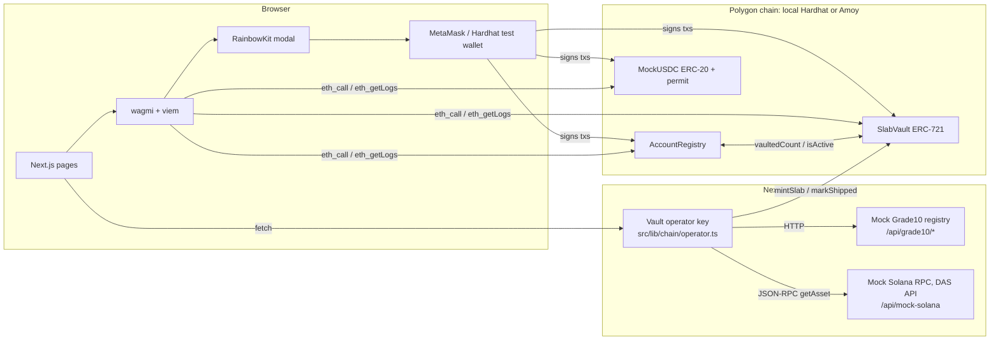
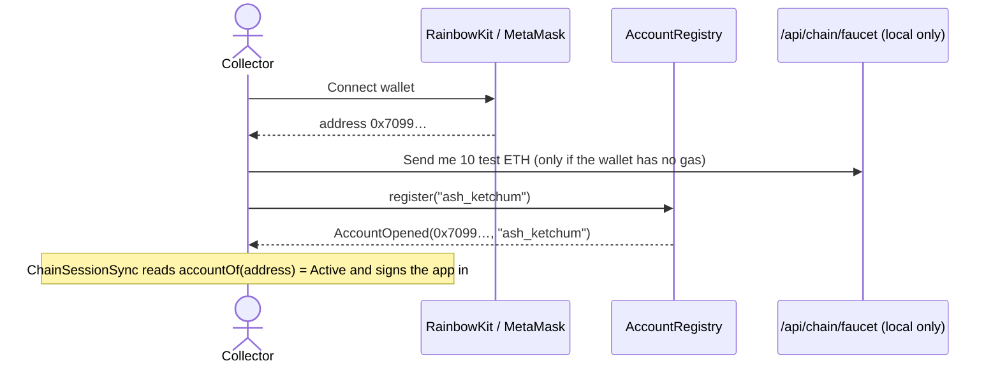
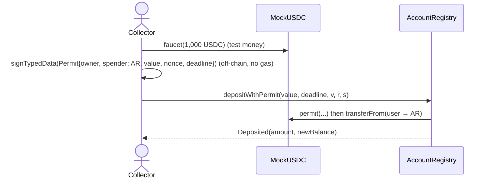
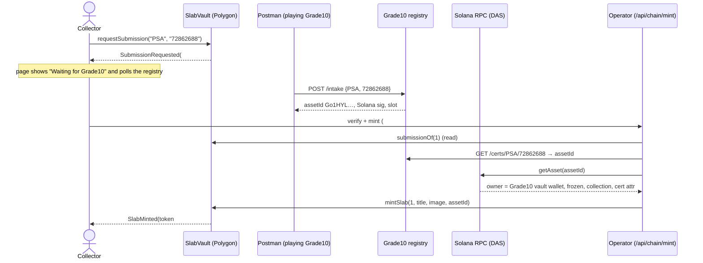
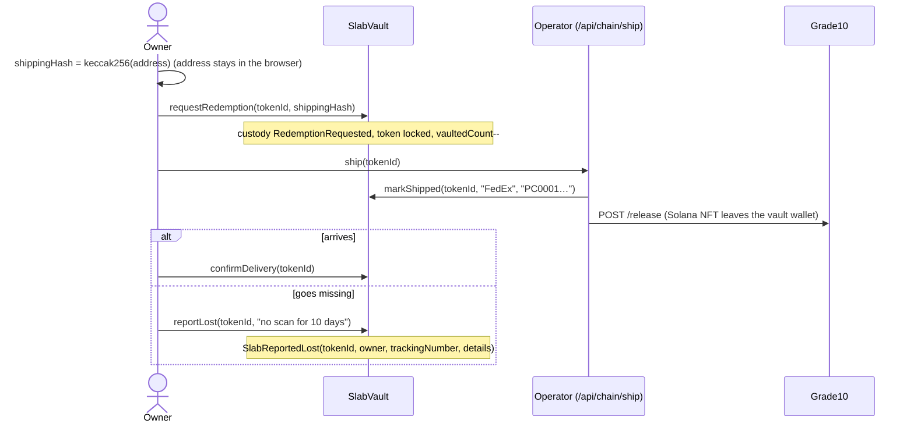

# Account and slab onboarding / offboarding on-chain

This branch moves the start and end of a collector's life on Pokechain onto a blockchain:

| | Onboarding | Offboarding |
| --- | --- | --- |
| **Account** | connect a wallet → `register(handle)` → deposit USDC | withdraw USDC → `closeAccount()` |
| **Slab** | `requestSubmission` → Grade10 receives it and records it on **Solana** → operator verifies that record → `mintSlab` (ERC-721 on Polygon) | `requestRedemption` (token locked, **never burned**) → `markShipped` → `confirmDelivery` or `reportLost` |

Trading (offers, negotiation rooms) is unchanged and still settles off-chain. That is the next branch.

---

## 1. Architecture



Two kinds of key sign transactions:

* **The collector's wallet** (MetaMask, held in the browser): register, deposit, withdraw, close,
  submit, redeem, confirm delivery, report lost.
* **The vault operator** (a server key, `OPERATOR_ROLE` in SlabVault): mint and ship. Only the
  party physically holding the slab can say "it's on our shelf" or "it's with the carrier". In
  production this would be a Safe multisig or a KMS key, not an env var.

---

## 2. Technologies and why each one is here

| Tool | Role in this project | Where |
| --- | --- | --- |
| **Solidity 0.8.28** | The three contracts | `blockchain/contracts/` |
| **OpenZeppelin Contracts 5** | `ERC721`, `ERC20`, `ERC20Permit` (EIP-2612), `AccessControl`, `Ownable`, `ReentrancyGuard`, `SafeERC20`, `Base64`. Audited building blocks instead of hand-rolled token logic | imported by every contract |
| **Hardhat 3** | Compiles, runs a local EVM node (`hardhat node`), runs Solidity unit and fuzz tests | `blockchain/hardhat.config.ts` |
| **Hardhat Ignition** | Declarative, resumable deployment: deploys the 3 contracts and wires them together | `blockchain/ignition/modules/Pokechain.ts` |
| **forge-std** | `Test`, `vm.prank`, `vm.expectRevert`, `vm.sign`, used inside Hardhat's Solidity test runner | `blockchain/test/Pokechain.t.sol` |
| **viem** | Typed Ethereum client: ABI encoding, `simulateContract`, `getContractEvents`, `keccak256`, signature parsing. Used in the browser and on the server | `src/lib/chain/*` |
| **wagmi 2** | React hooks over viem: wallet connection state, `useReadContracts` (multicall), `useWriteContract`, `useSignTypedData` | `src/lib/chain/*`, `src/components/chain/*` |
| **RainbowKit** | The Connect wallet modal (MetaMask, browser wallets, plus two local Hardhat test wallets) | `src/lib/chain/wagmi.ts` |
| **TanStack Query** | Caching and polling of chain reads (wagmi depends on it) | `Web3Providers.tsx` |
| **MetaMask** | The user's key store and transaction signer | the browser |
| **EIP-712 / EIP-2612** | Typed-data signature that authorises a USDC deposit without a separate `approve` tx | `OnChainFunds.tsx`, `AccountRegistry.depositWithPermit` |
| **Polygon Amoy** | Public testnet target (chain id 80002), explorer links to amoy.polygonscan.com | `npm run deploy:amoy` |
| **Solana DAS API** (Metaplex Digital Asset Standard, as served by Helius / Triton) | The shape of Grade10's custody record that the operator checks before minting | `src/lib/grade10/*`, `/api/mock-solana` |
| **Postman** | Plays Grade10 in a live demo; shows the raw Solana and operator calls | `docs/postman/` |

---

## 3. The contracts

### AccountRegistry (`blockchain/contracts/AccountRegistry.sol`)

| Function | Who | What it changes | Event / errors |
| --- | --- | --- | --- |
| `register(handle)` | wallet | Account → **Active**. Handle must be 3–20 chars of `a-z0-9_` and unclaimed. A Closed account may reopen | `AccountOpened` · `InvalidHandle`, `HandleTaken`, `AlreadyActive` |
| `deposit(amount)` | wallet | Pulls USDC via `transferFrom` (needs a prior `approve`), credits `balanceOf` | `Deposited` · `NotActive`, `ZeroAmount` |
| `depositWithPermit(amount, deadline, v, r, s)` | wallet | Same as above, authorised by an EIP-2612 signature: one tx instead of two | `Deposited` |
| `withdraw(amount)` | wallet | Debits `balanceOf`, sends USDC. Works on closed accounts too, so funds can't get stuck | `Withdrawn` · `InsufficientBalance` |
| `closeAccount()` | wallet | Refunds the whole balance, marks **Closed**. Reverts if `SlabVault.vaultedCount(you) > 0` | `AccountClosed` · `SlabsStillVaulted` |
| `accountOf`, `isActive`, `balanceOf`, `totalCustody` | anyone (view) | | |

### SlabVault (`blockchain/contracts/SlabVault.sol`), an ERC-721

Custody states: `Vaulted → RedemptionRequested → Shipped → Delivered`, or `→ Lost` (and an
operator can resolve Lost back to `Delivered` or `Vaulted`).

| Function | Who | What it changes | Event / errors |
| --- | --- | --- | --- |
| `requestSubmission(grader, cert)` | wallet | New **Pending** submission. One physical cert can only be tokenised once | `SubmissionRequested` · `AccountNotActive`, `CertAlreadyTokenised`, `CertAlreadyPending` |
| `mintSlab(submissionId, title, image, custodianRef)` | operator | Mints the token to the submitter, custody **Vaulted**, stores Grade10's **Solana asset id** | `SlabMinted` |
| `rejectSubmission(id, reason)` | operator | Submission → Rejected (e.g. the grader has no such cert) | `SubmissionRejected` |
| `requestRedemption(tokenId, shippingHash)` | owner | Custody → **RedemptionRequested**, token **locked**, `vaultedCount--`. Only `keccak256(address)` goes on-chain | `RedemptionRequested` |
| `markShipped(tokenId, carrier, tracking)` | operator | Custody → **Shipped** | `SlabShipped` |
| `confirmDelivery(tokenId)` | owner | Custody → **Delivered** | `SlabDelivered` |
| `reportLost(tokenId, details)` | owner | Custody → **Lost** (from RedemptionRequested or Shipped) | `SlabReportedLost` (carries the tracking number) |
| `resolveLostReport(tokenId, outcome)` | operator | Lost → Delivered, or back to Vaulted | `LostReportResolved` |
| `tokenURI(tokenId)` | view | **Fully on-chain metadata**: a base64 JSON document with grader, cert, Solana ref and live custody | |
| `_update` (internal hook) | every transfer | Transfers only while **Vaulted**, only **to an Active account**, and keeps `vaultedCount` right | `SlabLocked`, `AccountNotActive` |

### MockUSDC (`blockchain/contracts/MockUSDC.sol`)

ERC-20 with 6 decimals and `permit`, plus a public `faucet(amount)` (≤ 10,000). On a real
network you would point AccountRegistry at Circle's USDC instead.

### Why the token is never burned

You asked for withdrawn slabs to stay traceable. Burning would erase the owner, the cert link and
the custody trail at exactly the moment a parcel can go missing. Instead the token is **locked**:
`_update` refuses any transfer once custody leaves `Vaulted`. The owner keeps a permanent,
verifiable record and can file `reportLost` against it. The listing is removed from the marketplace
off-chain, and the slab shows under **Vault → Withdrawn**.

---

## 4. The flows, call by call

### Account onboarding



There is no password. "Logged in" means the connected wallet has an **Active** record in
AccountRegistry (`src/components/chain/ChainSessionSync.tsx`). Disconnecting the wallet signs you out.

### Deposit (permit)



### Slab onboarding with the Grade10 / Solana check

The assumption: collectors send slabs to **Grade10** ([grade10.com/vault](https://grade10.com/vault))
through Pokechain. Grade10 checks each slab in and records it on **Solana** as an NFT held (and
frozen) by its vault wallet. Pokechain won't mint until it has independently checked that record.



`src/lib/grade10/verify.ts` refuses to mint unless every check passes: owner is Grade10's vault
wallet, the NFT is frozen, not burnt, in Grade10's collection, and carries the same cert number.
Both URLs are env vars (`GRADE10_API_URL`, `SOLANA_RPC_URL`), so pointing them at real services
needs no code change: the request is standard DAS `getAsset` JSON-RPC.

The Polygon token stores the Solana asset id, and the Solana record names the cert. **Each chain
points at the other**, so either side can be audited from the other.

### Slab offboarding (withdraw, ship, deliver or lose)



### Account offboarding

`closeAccount()` checks `SlabVault.vaultedCount(you) == 0`, pays the custody balance back to the
wallet **in the same transaction**, marks the account Closed and emits `AccountClosed`. Nothing
is deleted: the handle stays reserved to that address, every event stays queryable, and the
tokens of withdrawn slabs still belong to the wallet.

---

## 5. "Database calls": the chain is the database

| Data | Where it lives | How the app reads it |
| --- | --- | --- |
| Account (handle, status, dates) | `AccountRegistry` storage | `accountOf(address)` |
| USDC in custody / in wallet | `AccountRegistry.balanceOf`, `MockUSDC.balanceOf` | One **multicall** of 5 `eth_call`s every 8 s (`useOnchainAccount.ts`) |
| Slab custody, tracking, Solana ref | `SlabVault.slabOf(tokenId)` | `useReadContracts` in `WithdrawnList.tsx` |
| Pending submissions | `SubmissionRequested` events + `submissionOf(id)` | `getContractEvents` filtered on the indexed `owner` topic (`PendingSubmissions.tsx`) |
| Full account history | All 11 event types across both contracts | `eth_getLogs` filtered on your address from the deploy block (`ChainHistory.tsx`, Account page) |
| Grade10 intake records | Mock Grade10 (`.data/grade10-intake.json`) | REST + Solana DAS JSON-RPC |
| Listings, offers, chats, wallet history | `localStorage` (unchanged) | React context (`src/lib/store.tsx`) |

Reads are free (`eth_call`, no gas). Writes are transactions. Events are the cheap, append-only
log that anyone can replay to rebuild state. That's why `ChainHistory` needs no Pokechain server. For
a 176-slab marketplace you would index these events with Ponder or The Graph (see
`docs/blockchain-stack.md`).

---

## 6. Showing the blockchain calls in a demo

* **Chain log** (bottom-left button, on every page). Every wallet tx, EIP-712 signature, operator tx
  and Grade10 / Solana check, with the exact function, arguments, sender, block, gas and tx hash.
  Source: `src/lib/chain/useChainTx.ts` (every write goes through `send()`, which runs
  `simulateContract` → `writeContract` → `waitForTransactionReceipt`).
* **"What happens on-chain" panels** under every action name the function, the checks it makes
  and the event it emits.
* **Account page** shows the raw view-function results, labelled with the call that produced each,
  plus the `eth_getLogs` history.
* **The Hardhat node terminal** prints every RPC call and every mined tx with gas and block.

### A 5-minute demo script

1. `npm run chain`, then `npm run dev`, and open http://localhost:3000.
2. **Sign up** → Connect wallet → *Hardhat test collector #1* (or MetaMask) → handle → **Open account**.
   Open the Chain log: `AccountRegistry.register`.
3. **Wallet** → *Mint 1,000 test USDC* → deposit 250 with the permit box ticked. The Chain log shows
   the off-chain **Signature**, then a single `depositWithPermit` tx.
4. **Submit** (`/submit`) → PSA `72862688` → *Submit and send to Grade10*. It waits.
5. In **Postman**, send *1 · Grade10 intake*. The page mints within seconds. The Chain log shows
   `Grade10 GET /certs`, `Solana getAsset`, then the operator's `SlabVault.mintSlab`. Send
   *3 · getAsset* in Postman to show the record the operator checked.
6. **Vault** → *Ship to me* → enter an address → *Withdraw*. The Withdrawn tab shows token #1, still
   yours, with its custody trail. Click **Report lost**.
7. **Account** → read the history, then **Close account**: the $250 comes back and status is Closed.
8. Optional: switch to *Hardhat test collector #2* and try `register("ash_ketchum")`. It reverts
   with `HandleTaken`: handles stay reserved after offboarding.

---

## 7. Security decisions worth mentioning

* **Checks-effects-interactions + `nonReentrant`** on every function that moves USDC.
  `totalCustody` always equals the USDC the contract holds (fuzz-tested).
* **Role separation** with `AccessControl`: only `OPERATOR_ROLE` can mint or ship. Collectors can only
  act on their own tokens (`NotSlabOwner`).
* **Cross-chain custody proof** before minting, so a token can't exist for a slab Grade10 doesn't hold.
* **One cert, one token** (`tokenOfCert`, `pendingSubmissionOfCert`): no double-tokenising.
* **Locked, not burned** on redemption: no trading of a slab that's in transit, and a permanent trail.
* **Only active accounts can receive slabs** (`_update`), the on-chain equivalent of a KYC gate.
* **Privacy:** the shipping address never goes on-chain, only `keccak256(address)`, which the
  operator can later match.
* **Permit front-running tolerated:** `depositWithPermit` wraps `permit` in `try/catch`, so a
  front-run permit can't block the deposit.
* **Custom errors** (cheaper than revert strings), decoded into friendly text by
  `describeError` in `useChainTx.ts`, after a `simulateContract` dry run that catches the revert
  before the wallet even opens.

---

## 8. Recreate it from scratch

Requirements: Node 20+ (`./dev.sh` pins Homebrew Node), and optionally MetaMask.

```bash
npm run setup          # installs the app and blockchain/ dependencies
npm run contracts:test # 22 Solidity unit + fuzz tests
npm run chain          # terminal 1: local chain + deploy + ABI export (leave running)
npm run dev            # terminal 2: the app on http://localhost:3000
```

`npm run chain` starts a fresh Hardhat node, deploys with Ignition and runs
`blockchain/scripts/export-frontend.mjs`. That writes every ABI and address into
`src/lib/chain/generated.ts`, so the frontend's types always match the deployed contracts. The node
is in-memory: restart it and everything resets to block 0 (with the same addresses). Use
**Reset demo data** in the user menu to clear the browser side too.

**Using MetaMask on the local chain:** connect with MetaMask and approve *Add network* (RPC
`http://127.0.0.1:8545`, chain id 31337). Press *Send me 10 test ETH* for gas. After restarting the
chain, use MetaMask → Settings → Advanced → **Clear activity tab data**, or it will reuse stale nonces.

### Deploy to Polygon Amoy

```bash
cd blockchain
npx hardhat keystore set AMOY_RPC_URL       # e.g. an Alchemy / Infura Amoy URL
npx hardhat keystore set AMOY_PRIVATE_KEY   # a throwaway key funded from faucet.polygon.technology
npm run deploy:amoy                         # deploys + exports addresses for chain 80002
```

Then in `.env.local`: `NEXT_PUBLIC_CHAIN=amoy` and `OPERATOR_PRIVATE_KEY=<the same key>` (the
deployer is the operator). Chain log entries now link to amoy.polygonscan.com.

### Postman

Import `docs/postman/Pokechain.postman_collection.json`. Collection variables: `baseUrl`
(default `http://localhost:3000`), `grader`, `certNumber`, `submissionId`, `tokenId`. Request 1
stores the returned `assetId` for requests 3 and onwards.

---

## 9. File map

```
blockchain/
  contracts/AccountRegistry.sol   account onboarding / offboarding, USDC custody
  contracts/SlabVault.sol         ERC-721 slab tokens, custody state machine
  contracts/MockUSDC.sol          test USDC with EIP-2612 permit
  test/Pokechain.t.sol            22 unit + fuzz tests
  ignition/modules/Pokechain.ts   deployment + wiring
  scripts/dev-chain.mjs           npm run chain
  scripts/export-frontend.mjs     ABIs + addresses → src/lib/chain/generated.ts
src/lib/chain/
  config.ts          chain selection, contract {address, abi}, enums, explorer links
  wagmi.ts           RainbowKit wallets, Hardhat test wallets, wagmi config
  useChainTx.ts      simulate → write → receipt, error decoding, Chain log
  useOnchainAccount.ts  multicall of the account's on-chain state
  useSlabChain.ts    submit / verify+mint / redeem / confirm / report lost
  operator.ts        server-side operator key: mintSlab, markShipped, gas faucet
src/lib/grade10/
  registry.ts        mock Grade10: intake records, Solana-format ids, DAS asset shape
  verify.ts          the Grade10 registry + Solana getAsset custody check
src/app/api/
  chain/{mint,ship,faucet}   operator routes
  grade10/{intake,certs,release}  mock Grade10 REST
  mock-solana                mock Solana DAS JSON-RPC
src/components/chain/        AccountView, OnChainFunds, PendingSubmissions, RedeemModal,
                             WithdrawnList, ChainHistory, ChainConsole, ChainSessionSync
```

## 10. Limitations (what to say if asked)

* Grade10's API and Solana record are **mocked**. The request shapes are the real ones (REST lookup,
  DAS `getAsset`), but nothing is on Solana devnet. Swapping in real endpoints is two env vars.
* The operator API routes are unauthenticated. They only act on state already on-chain (a pending
  submission or a requested redemption), but production would also authenticate the caller and
  run the operator as a multisig.
* Offers and trades still use the off-chain wallet balance. Deposits and withdrawals are mirrored
  into it with their tx hash. Moving trades into an escrow contract is the next step
  (`docs/blockchain-stack.md`, section 1).
* Slabs bought off-chain are tokenised on first withdrawal (the same submit → Grade10 → mint path).
