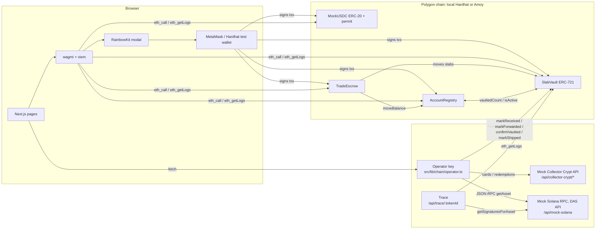
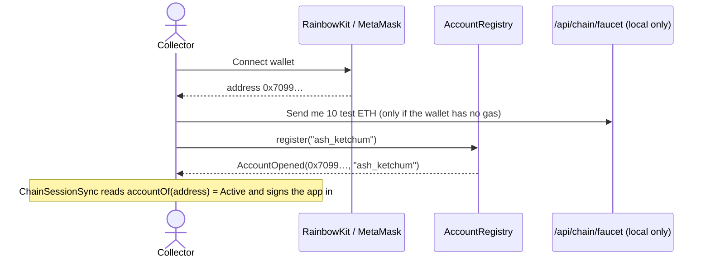
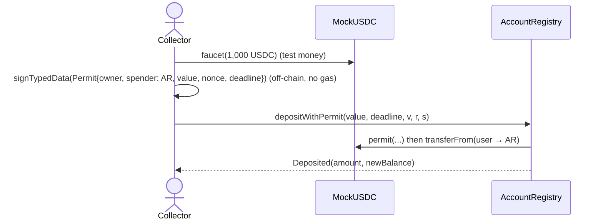
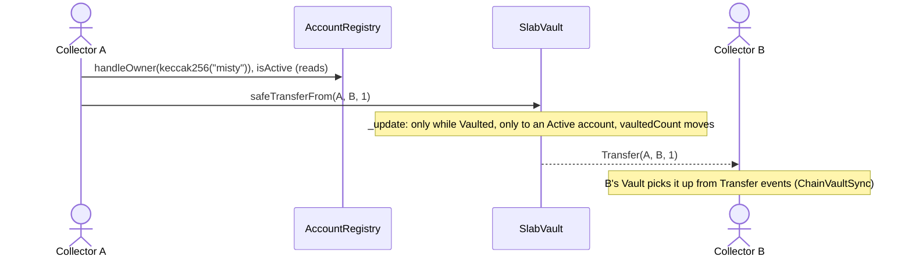
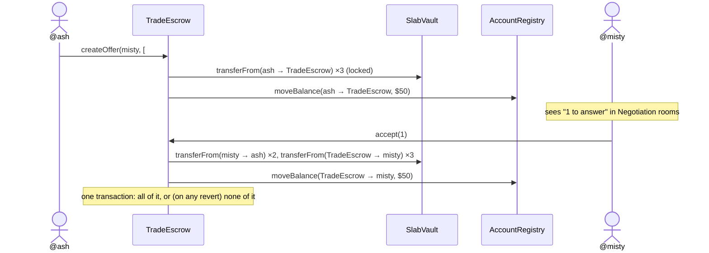
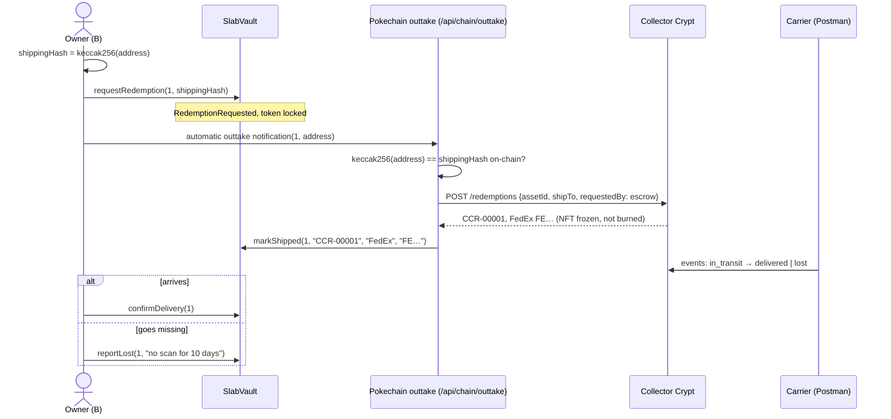

# Account and slab onboarding / offboarding on-chain

This branch moves the start and end of a collector's life on Pokechain onto a blockchain:

| | Onboarding | Offboarding |
| --- | --- | --- |
| **Account** | connect a wallet → `register(handle)` → deposit USDC | withdraw USDC → `closeAccount()` |
| **Slab** | `requestSubmission` creates the intake → Pokechain receives it (`markReceived`) and mints a locked ERC-721 whose id is the numeric PSA cert → forwards it to **Collector Crypt** (`markForwarded`) → CC vaults it and mints its **Solana** NFT to Pokechain's escrow → operator verifies that NFT → `confirmVaulted` (now tradeable). Lost in the post on the way in: `reportLost` | `requestRedemption` (token locked) → Pokechain asks CC to ship → `markShipped` (with CC's redemption id) → `confirmDelivery` burns the Pokechain NFT, or `reportLost` keeps it pending for recovery |
| **Ownership** | | A → B: `safeTransferFrom`, or a **TradeEscrow** swap of several slabs + cash both ways, settled in one transaction. CC's NFTs never move |

**The model in one line:** the physical slab sits in Collector Crypt's vault, CC's Solana NFT for it
sits locked in Pokechain's escrow wallet, and Pokechain's Polygon token is the tradeable title.
Trading moves only the Polygon token. Whoever holds it when they withdraw is who Collector Crypt ships to.

Trades between collectors run on **TradeEscrow** (section 3 and "Multi-slab trades" in section 4):
"3 Pikachus + $50 for your 2 Articunos" is one offer, locked in escrow, and settles all at once.
The marketplace's simulated sellers (the 176 catalogue listings) still trade off-chain.

---

## 1. Architecture



Two kinds of key sign transactions:

* **The collector's wallet** (MetaMask, held in the browser): register, deposit, withdraw, close,
  submit, redeem, confirm delivery, report lost, and every trade action (offer, accept, decline,
  withdraw, counter).
* **The Pokechain operator** (a server key, `OPERATOR_ROLE` in SlabVault): receive, forward, confirm
  vaulted, ship, and resolve lost reports. It has no power over trades. Only Pokechain's warehouse can say "the parcel arrived" or "we sent it to Collector
  Crypt", and only the holder of CC's NFT can ask CC to ship. In production this would be a Safe
  multisig or a KMS key, not an env var. (Multisig is deliberately left out of this round.)

---

## 2. Technologies and why each one is here

| Tool | Role in this project | Where |
| --- | --- | --- |
| **Solidity 0.8.28** | The three contracts | `blockchain/contracts/` |
| **OpenZeppelin Contracts 5** | `ERC721`, `ERC20`, `ERC20Permit` (EIP-2612), `AccessControl`, `Ownable`, `ReentrancyGuard`, `SafeERC20`, `Base64`. Audited building blocks instead of hand-rolled token logic | imported by every contract |
| **Hardhat 3** | Compiles, runs a local EVM node (`hardhat node`), runs Solidity unit and fuzz tests | `blockchain/hardhat.config.ts` |
| **Hardhat Ignition** | Declarative, resumable deployment: deploys the 3 contracts and wires them together | `blockchain/ignition/modules/Pokechain.ts` |
| **forge-std** | `Test`, `vm.prank`, `vm.expectRevert`, `vm.sign`, used inside Hardhat's Solidity test runner | `blockchain/test/Pokechain.t.sol` |
| **viem** | Typed Ethereum client: ABI encoding, `simulateContract`, `getContractEvents`, `keccak256`, signature parsing. Used in the browser and on the server | `src/lib/chain/*` |
| **wagmi 2** | React hooks over viem: wallet connection state, `useReadContracts` (multicall), `useWriteContract`, `useSignTypedData` | `src/lib/chain/*`, `src/components/chain/*` |
| **RainbowKit** | The Connect wallet modal (MetaMask, browser wallets, plus two local Hardhat test wallets) | `src/lib/chain/wagmi.ts` |
| **TanStack Query** | Caching and polling of chain reads (wagmi depends on it) | `Web3Providers.tsx` |
| **MetaMask** | The user's key store and transaction signer | the browser |
| **EIP-712 / EIP-2612** | Typed-data signature that authorises a USDC deposit without a separate `approve` tx | `OnChainFunds.tsx`, `AccountRegistry.depositWithPermit` |
| **Polygon Amoy** | Public testnet target (chain id 80002), explorer links to amoy.polygonscan.com | `npm run deploy:amoy` |
| **Solana DAS API** (Metaplex Digital Asset Standard, as served by Helius / Triton) | `getAsset` (is CC's NFT in our escrow?), `getSignaturesForAsset` (its history), `getAssetsByOwner` (everything in escrow) | `src/lib/collectorCrypt/*`, `/api/mock-solana` |
| **Collector Crypt** (simulated) | The vault: intake, card lookup, redemptions with carrier tracking | `/api/collector-crypt/*` |
| **Postman** | Plays Pokechain's warehouse, Collector Crypt and the carrier in a live demo | `docs/postman/` |

---

## 3. The contracts

### AccountRegistry (`blockchain/contracts/AccountRegistry.sol`)

| Function | Who | What it changes | Event / errors |
| --- | --- | --- | --- |
| `register(handle)` | wallet | Account → **Active**. Handle must be 3–20 chars of `a-z0-9_` and unclaimed. A Closed account may reopen | `AccountOpened` · `InvalidHandle`, `HandleTaken`, `AlreadyActive` |
| `deposit(amount)` | wallet | Pulls USDC via `transferFrom` (needs a prior `approve`), credits `balanceOf` | `Deposited` · `NotActive`, `ZeroAmount` |
| `depositWithPermit(amount, deadline, v, r, s)` | wallet | Same as above, authorised by an EIP-2612 signature: one tx instead of two | `Deposited` |
| `withdraw(amount)` | wallet | Debits `balanceOf`, sends USDC. Works on closed accounts too, so funds can't get stuck | `Withdrawn` · `InsufficientBalance` |
| `closeAccount()` | wallet | Refunds the whole balance, marks **Closed**. Reverts if `SlabVault.vaultedCount(you) > 0` | `AccountClosed` · `SlabsStillVaulted` |
| `accountOf`, `isActive`, `balanceOf`, `totalCustody` | anyone (view) | | |

### SlabVault (`blockchain/contracts/SlabVault.sol`), an ERC-721

Custody states. Inbound, from the moment of submission:
`PostedToPokechain → AtPokechain → SentToCustodian → Vaulted` (or `Rejected`, token kept as the record).
Outbound: `Vaulted → RedemptionRequested → Shipped → Delivered`. From any in-the-post state
(`PostedToPokechain`, `SentToCustodian`, `RedemptionRequested`, `Shipped`) the owner can report it `Lost`,
and the operator resolves it to `AtPokechain` (inbound parcel found), `Delivered` or `Vaulted`.
The token can only move (transfer, trade) while **Vaulted**. Token id = submission id.

| Function | Who | What it changes | Event / errors |
| --- | --- | --- | --- |
| `requestSubmission(grader, cert, evidenceHash, inboundCarrier, inboundTracking)` | wallet | **Mints the NFT to the submitter right away**, custody **PostedToPokechain**, locked and not counted as vaulted. Carries the fingerprint of the intake photos and declarations, and the parcel's tracking number, so a parcel lost in the post is already a token that can be reported. One physical cert has one live token | `SubmissionRequested`, `Transfer(0 → you)` · `AccountNotActive`, `CertAlreadyTokenised`, `MissingEvidence` |
| `markReceived(submissionId)` | operator | → **AtPokechain** (submission ReceivedByPokechain) | `SubmissionReceived` · `WrongSubmissionStatus` |
| `markForwarded(submissionId, ciphertext, commitment)` | operator | → **SentToCustodian**; the parcel details go on-chain only encrypted to the custodian's published key, plus a salted commitment | `SubmissionForwarded` · `NoEncryptionKey` |
| `setEncryptionKey(key)` / `setCustodian(address)` | anyone / admin | Publish your X25519 public key; name the custodian (Collector Crypt) | `EncryptionKeySet`, `CustodianSet` |
| `verifyForwardCommitment(id, message, salt)` | view | Dispute check: true only for exactly what was committed at forwarding | |
| `confirmVaulted(tokenId, title, image, custodianRef)` | operator | Only from SentToCustodian, after the Solana check. Custody **Vaulted**, stores **CC's Solana asset id**, counts it as vaulted: the token can now be traded | `SlabVaulted` |
| `rejectSubmission(id, reason)` | operator | Any open stage → **Rejected** (e.g. no such cert, damaged slab). The token stays as the record; the cert is freed | `SubmissionRejected` |
| `safeTransferFrom(from, to, tokenId)` | owner | **A → B**: the title changes hands. CC's NFT doesn't move | `Transfer` · `SlabLocked`, `AccountNotActive` |
| `requestRedemption(tokenId, shippingHash)` | owner | Custody → **RedemptionRequested**, token **locked**, `vaultedCount--`. Only `keccak256(address)` goes on-chain | `RedemptionRequested` |
| `markShipped(tokenId, redemptionRef, carrier, tracking)` | operator | Custody → **Shipped**; stores **CC's redemption id** | `SlabShipped` |
| `confirmDelivery(tokenId)` | owner | Custody → **Delivered** | `SlabDelivered` |
| `reportLost(tokenId, details)` | owner | Custody → **Lost**, from any in-the-post state, inbound or outbound | `SlabReportedLost` (carries the tracking number) |
| `resolveLostReport(tokenId, outcome)` | operator | Lost → AtPokechain (inbound, found), Delivered, or back to Vaulted | `LostReportResolved` |
| `setTradeEscrow(address)`, `isApprovedForAll` | admin / view | Names TradeEscrow, which may then move slabs without a per-token approval (it only does so inside a call signed by that slab's owner) | `TradeEscrowSet` |
| `tokenURI(tokenId)` | view | **Fully on-chain metadata**: a base64 JSON document with grader, cert, Collector Crypt's Solana id, live custody, and the evidence hash of the owner's intake form | |
| `_update` (internal hook) | every transfer | Transfers only while **Vaulted**, only **to an Active account other than the owner**, and keeps `vaultedCount` right | `SlabLocked`, `AccountNotActive`, `SelfTransfer` |

### TradeEscrow (`blockchain/contracts/TradeEscrow.sol`)

Swaps between two collectors with **slabs and cash on both sides**, like a real-life trade:
"3 Pikachus and $50 for 2 of your Articunos", or "2 Charizards + $300 for 2 of your Bulbasaurs + $20".

| Function | Who | What it changes | Event / errors |
| --- | --- | --- | --- |
| `createOffer(taker, makerSlabs, makerCash, takerSlabs, takerCash, room)` | maker | Locks the maker's side: their slabs move into TradeEscrow, their cash moves to its custody balance (`AccountRegistry.moveBalance`). Checks both sides now: every slab owned by the right person and **Vaulted**, enough cash, no duplicates, ≤ 10 slabs a side, each side non-empty | `OfferCreated` · `SelfTrade`, `EmptySide`, `NotYourSlab`, `SlabNotVaulted`, `NotEnoughCash`, `DuplicateSlab`, `TooManySlabs` |
| `accept(offerId)` | taker | **One transaction:** taker's slabs + cash → maker, escrowed slabs + cash → taker. If any piece can't move, everything reverts | `OfferAccepted` · `NotTaker`, `OfferNotOpen` |
| `decline(offerId)` / `withdraw(offerId)` | taker / maker | Refunds the maker's escrowed side | `OfferDeclined` / `OfferWithdrawn` |
| `counter(offerId, mySlabs, myCash, theirSlabs, theirCash)` | taker | Refunds the offer and makes the taker's own offer back, locking their side, in one transaction | `OfferCountered`, `OfferCreated` |
| `offerOf`, `offerIdsOf`, `openOffers`, `offerHolding` | view | What the app reads to draw trade rooms and mark slabs "In offer" | |

AccountRegistry gains `moveBalance(from, to, amount)` (TradeEscrow only; `totalCustody` never changes)
and refuses `closeAccount` while the account has open offers (`OffersStillOpen`).

### MockUSDC (`blockchain/contracts/MockUSDC.sol`)

ERC-20 with 6 decimals and `permit`, plus a public `faucet(amount)` (≤ 10,000). On a real
network you would point AccountRegistry at Circle's USDC instead.

### Why the token burns only after owner-confirmed receipt

During withdrawal, the token is **locked**, not burned: `_update` refuses transfers once custody
leaves `Vaulted`, and the owner can still file `reportLost` and attach a bounty. Pokechain/CC can
verify a found slab and move it back to `Shipped`. Only `confirmDelivery`, signed by the latest
owner after physical receipt, moves it to `Delivered` and burns the title NFT. The slab record,
certificate link and events remain queryable after the burn.

**Does Collector Crypt burn its NFT on redemption?** We don't know, so the design works either way:

* The simulated CC **doesn't burn**. On redemption its NFT stays in Pokechain's escrow, **frozen**
  and marked with the redemption, so it can never be redeemed twice. Each carrier outcome
  (delivered, lost) is written to its metadata as a Solana transaction.
* If the real CC **does burn**, the burn is itself a Solana transaction in the NFT's history
  (`getSignaturesForAsset`). Pokechain's own token still holds CC's asset id, CC's redemption id and
  the tracking number, so the trail survives on Polygon after Pokechain's receipt-gated burn.

The **Trace** page (`/trace/<tokenId>`) puts all three records side by side.

---

## 4. The flows, call by call

### Account onboarding



There is no password. "Logged in" means the connected wallet has an **Active** record in
AccountRegistry (`src/components/chain/ChainSessionSync.tsx`). Disconnecting the wallet signs you out.

### Deposit (permit)



### The intake form and its evidence hash

The Submit page is a realistic intake form for wallet accounts:

1. **The slab:** grader and cert number, looked up in the grader's registry, with an estimated value.
2. **Photos:** front, back and a close-up of the grading label (required), plus an optional extra.
3. **Condition:** damage checkboxes and notes.
4. **Getting it to Pokechain:** courier (carrier + tracking number) or drop-off.
5. **Declarations:** ownership, authenticity, and the vault and storage terms.

Only a fingerprint of that goes on-chain:

```
each photo     →  keccak256(file bytes)                      listed in a manifest
the manifest   →  keccak256(manifest JSON) = evidenceHash    SlabVault.requestSubmission(…, evidenceHash, …)
```

The photos stay off-chain (`POST /api/evidence`, stored in `.data/evidence/`; in production, IPFS
or an object-locked bucket). Change one pixel or a note and the hash no longer
matches. When the slab reaches Pokechain, `markReceived` only goes ahead if the stored evidence
still hashes to the on-chain value; otherwise the operator calls `rejectSubmission`. The token
keeps the `evidenceHash` forever, in `slabOf` and in its own `tokenURI` metadata.
The Trace page re-hashes the photos on every view, so a lost or damage claim can prove exactly what
was declared at intake.

**Does the token tally with the form?** On a tokenised slab's page, *Your submission vs the token*
puts each field you entered (grader, cert, shipping, photos and notes) beside what
`slabOf` / `submissionOf` hold. It then decodes the NFT's own `tokenURI` and checks each attribute
too, with a tick or cross per field. The Vault and the asset page show the catalogue's market estimate,
or the asking price while the slab is listed.

### Slab onboarding: you → Pokechain → Collector Crypt → token

The slab's physical journey is recorded step by step, so the inbound leg is as traceable as the
outbound one. **The NFT is minted at submission**, pending and locked, so a parcel lost in the post
already has a token to report it against. It only becomes tradeable (`confirmVaulted`) once
Collector Crypt's NFT is provably in Pokechain's escrow.

```mermaid
sequenceDiagram
  actor A as Collector A
  participant SV as SlabVault (Polygon)
  participant O as Pokechain operator
  participant CC as Collector Crypt (Postman)
  participant S as Solana RPC (DAS)
  A->>A: POST /api/evidence (photos + declarations) → evidenceHash
  A->>SV: requestSubmission("PSA", "72862688", evidenceHash, "SingPost", "RR…SG")
  SV-->>A: Transfer(0 → A, token #1), custody PostedToPokechain (locked)
  Note over A: ships the slab to Pokechain (lost? A calls reportLost(1))
  O->>SV: markReceived(1)        (cert + evidence hash checked; else rejectSubmission)
  O->>SV: markForwarded(1, ciphertext, commitment)   (details encrypted to CC's on-chain key)
  CC->>CC: POST /intake → vaults it, mints NFT to Pokechain escrow
  Note over A: page polls CC's card lookup
  O->>CC: GET /cards/PSA/72862688 → assetId
  O->>S: getAsset(assetId)
  S-->>O: owner = Pokechain escrow, CC collection, cert, Vaulted, not burnt
  O->>SV: confirmVaulted(1, title, image, assetId)
  SV-->>A: SlabVaulted(token #1, custodianRef = assetId), now tradeable
```

`src/lib/collectorCrypt/client.ts` (`verifyCustody`) refuses to confirm unless every check passes.
Both URLs are env vars (`CC_API_URL`, `SOLANA_RPC_URL`), so pointing them at real services needs
no code change: the Solana call is standard DAS `getAsset` JSON-RPC.

The Polygon token stores CC's asset id, and CC's NFT names the cert. **Each chain points at the
other**, so either side can be audited from the other.

### Sending private data through the chain: the encrypted forward

Collector Crypt needs to know which parcel to expect (carrier, tracking number, which slab), but
tracking numbers shouldn't be public. So the details travel **through the contract, encrypted**:

1. **Keys on-chain.** Collector Crypt publishes an X25519 public key with
   `SlabVault.setEncryptionKey(key)`; its private key stays on its server. The admin names it the
   custodian with `setCustodian(address)` (deployment parameter, `ignition/parameters/local.json`).
2. **Encrypt to the on-chain key.** Pokechain reads `encryptionKey(custodian)` and seals the
   details to it: a one-time X25519 key exchange, HKDF-SHA256, then XChaCha20-Poly1305
   (`src/lib/sealed/envelope.ts`, using the audited `@noble` libraries).
3. **Post ciphertext + commitment.** `markForwarded(id, ciphertext, commitment)` stores
   `commitment = keccak256(salt ‖ message)` and emits `SubmissionForwarded(id, owner, recipient,
   recipientKey, commitment, ciphertext)`. It reverts with `NoEncryptionKey` if the custodian has no
   key. **No plaintext goes on-chain**; Pokechain keeps the message and salt off-chain.
4. **Collector Crypt reads its inbox.** It filters `SubmissionForwarded` on its own address (an
   indexed topic) and decrypts each one with its private key. **/collector-crypt** shows both sides
   next to each other: the ciphertext anyone can read, and the decrypted details only CC can read.
   The transaction's sender (Pokechain's operator) proves who sent it and when.
5. **Disputes are settled by the contract.** Pokechain reveals the message and salt;
   `verifyForwardCommitment(id, message, salt)` returns true only for exactly what was committed
   (fuzz-tested: no other message/salt passes).

The same pattern works for any leg (e.g. tracking for a redemption encrypted to the buyer's key),
and calling `setEncryptionKey` again rotates a key; each event records which key it used.

### Ownership change: A → B



Collector Crypt's NFT doesn't move: it stays in Pokechain's escrow. **No separate contract is needed
to keep it still.** It moves only when Pokechain, its holder, asks CC to ship.

### Multi-slab trades: slabs and cash both ways



Both collectors see the same room from their own browsers because it is read from the chain
(`offerIdsOf` + `offerOf`, refreshed on `OfferCreated/Accepted/Declined/Withdrawn` events). While an
offer is open the maker's slabs show in their Vault as **In offer #N**, and can't be transferred,
withdrawn or offered twice.

### Slab offboarding: B withdraws, Collector Crypt ships to B



The server only ships to the address whose hash the owner signed on-chain, so nobody can redirect
the parcel, not even someone calling the operator route directly.

### Account offboarding

`closeAccount()` checks `SlabVault.vaultedCount(you) == 0`, pays the custody balance back to the
wallet **in the same transaction**, marks the account Closed and emits `AccountClosed`. Nothing
is deleted: the handle stays reserved to that address, every event stays queryable, and the
tokens of withdrawn slabs still belong to the wallet.

---

## 5. "Database calls": the chain is the database

| Data | Where it lives | How the app reads it |
| --- | --- | --- |
| Account (handle, status, dates) | `AccountRegistry` storage | `accountOf(address)` |
| USDC in custody / in wallet | `AccountRegistry.balanceOf`, `MockUSDC.balanceOf` | One **multicall** of 5 `eth_call`s every 8 s (`useOnchainAccount.ts`) |
| Which tokenised slabs you own | `Transfer` events + `ownerOf` | `ChainVaultSync.tsx`: the Vault follows the chain, so a slab sent to you appears and one you sent leaves |
| Slab custody, CC redemption id, tracking | `SlabVault.slabOf(tokenId)` | `useReadContracts` in `WithdrawnList.tsx` |
| Inbound stage of a submission | `SubmissionRequested` events + `submissionOf(id)` | `getContractEvents` filtered on the indexed `owner` topic (`PendingSubmissions.tsx`) |
| Full account history | Every event across both contracts, plus transfers in and out | `eth_getLogs` filtered on your address from the deploy block (`ChainHistory.tsx`, Account page) |
| One slab's whole journey | SlabVault events by `tokenId` / `submissionId` + Solana + CC | `src/lib/chain/trace.ts` → `/trace/<tokenId>` |
| Collector Crypt records | Mock CC (`.data/collector-crypt.json`, cleared by `npm run chain`) | REST + Solana DAS JSON-RPC |
| Listings, offers, chats, wallet history | `localStorage` (unchanged) | React context (`src/lib/store.tsx`) |

Reads are free (`eth_call`, no gas). Writes are transactions. Events are the cheap, append-only
log that anyone can replay to rebuild state. That's why `ChainHistory` needs no Pokechain server. For
a 176-slab marketplace you would index these events with Ponder or The Graph (see
`docs/blockchain-stack.md`).

---

## 6. Showing the blockchain calls in a demo

* **Chain log** (bottom-left button, on every page). Every wallet tx, EIP-712 signature, operator tx
  and Collector Crypt / Solana call, with the exact function, arguments, sender, block, gas and tx hash.
  Source: `src/lib/chain/useChainTx.ts` (every write goes through `send()`, which runs
  `simulateContract` → `writeContract` → `waitForTransactionReceipt`).
* **"What happens on-chain" panels** under every action name the function, the checks it makes
  and the event it emits.
* **Account page** shows your on-chain status, the close-account check, and the `eth_getLogs` history.
* **Trace page** (`/trace/<tokenId>`, linked from every token) lines up Polygon events, Solana
  transactions and Collector Crypt's carrier scans in one timeline.
* **The Hardhat node terminal** prints every RPC call and every mined tx with gas and block.

### A 6-minute demo script

1. `npm run chain`, then `npm run dev`, and open http://localhost:3000.
2. **Sign up** → Connect wallet → *test1 wallet* (or MetaMask) → handle `ash` → **Open account**.
   Open the Chain log: `AccountRegistry.register`.
3. **Wallet** → *Mint 1,000 test USDC* → deposit 250 with the permit box ticked. The Chain log shows
   the off-chain **Signature**, then a single `depositWithPermit` tx.
4. **Submit** (`/submit`): PSA `72862688`, *Use sample photos (demo)* (or real photos), *Use estimate*,
   a tracking number, the three declarations, then *Upload evidence and submit on-chain*. The Chain log
   shows `POST /api/evidence` (3 photos hashed) and then `requestSubmission(…, evidenceHash, …)`. A tracker appears.
5. In **Postman**, send *1 · receive*, *2 · forward*, *3 · Collector Crypt vaults it*. The tracker
   moves at each step; after 3 the page confirms it. The Chain log shows `markReceived`, `markForwarded`,
   `Collector Crypt GET /cards`, `Solana getAsset`, then `SlabVault.confirmVaulted`. Send *4 · getAsset* to
   show the escrow-held NFT the operator checked. (Each step also has a Simulate button.)
6. Sign out, connect *test2 wallet*, open account `misty`. Sign back in as `ash`,
   then in the **Vault** → **Transfer** → `misty`. Ash's Vault empties; switch to misty, and token #1 is
   in her Vault (read from `Transfer` events).
7. As misty: **Ship to me** → address → *Withdraw*. Collector Crypt redemption `CCR-00001` is created
   and recorded with `markShipped`.
8. In **Postman**, send *7 · in transit* and *8 · lost*. Then in the **Withdrawn** tab → **Report lost**.
9. Open **Trace** for token #1: Polygon, Solana and Collector Crypt, side by side.
10. **Account** → history, then **Close account** (allowed now that no slabs are vaulted).

**Multi-slab trade demo (2 minutes).** `npm run chain` seeds the demo. Log in with the **test1 wallet**
→ **Negotiation rooms** → **Chat** next to **@test2** → send a message → **Make a trade offer**: the slab the
chat is about is already picked; add slabs from your vault and cash if you like. Review the same card's
Pokechain listings and completed transactions using each slab's comparison link. No FMV or fairness score
is assigned; both collectors choose their own terms → **Send offer** (Chain log: `TradeEscrow.createOffer`; your Vault shows
**In offer #1**). Sign out, log in with the **test2 wallet**, open the chat → **Accept trade** (or
**Counter** / **Decline**). The slab's page then shows **Sold**.

---

## 7. Security decisions worth mentioning

* **Checks-effects-interactions + `nonReentrant`** on every function that moves USDC.
  `totalCustody` always equals the USDC the contract holds (fuzz-tested).
* **Role separation** with `AccessControl`: only `OPERATOR_ROLE` can mint or ship. Collectors can only
  act on their own tokens (`NotSlabOwner`).
* **Cross-chain custody proof** before minting, so a token can't exist unless Collector Crypt's NFT
  for that slab is in Pokechain's escrow.
* **Enforced stage order** for the inbound trail (`_moveSubmission` → `WrongSubmissionStatus`): no
  minting before the slab has reached Collector Crypt.
* **Ship only where the owner signed:** the operator ships only to an address whose `keccak256`
  matches the `shippingHash` the owner put on-chain.
* **CC's NFT never moves while trading**, so the same slab can't be sold on Pokechain and redeemed
  or sold elsewhere. CC refuses redemptions from anyone but the NFT's holder.
* **One cert, one live token** (`tokenOfCert`), from the moment of submission: no double-tokenising.
* **Pending tokens are locked** (`_update` refuses anything but Vaulted), so a slab nobody has checked yet can't be sold.
* **Atomic trades:** `accept` moves both sides in one transaction; a slab withdrawn or traded away in
  the meantime makes it revert, so nobody ever gets half a trade (fuzz-tested: cash is conserved).
* **No approvals to phish:** TradeEscrow is a built-in operator of SlabVault, but only moves a slab in
  a call its owner signed (their own `createOffer` or `accept`).
* **Locked during redemption; burned only on confirmed receipt:** no trading of a slab in transit, while the custody record remains permanent.
* **Only active accounts can receive slabs** (`_update`), the on-chain equivalent of a KYC gate.
* **Privacy:** the shipping address never goes on-chain, only `keccak256(address)`, which the
  operator can later match.
* **Permit front-running tolerated:** `depositWithPermit` wraps `permit` in `try/catch`, so a
  front-run permit can't block the deposit.
* **Custom errors** (cheaper than revert strings), decoded into friendly text by
  `describeError` in `useChainTx.ts`, after a `simulateContract` dry run that catches the revert
  before the wallet even opens.

---

## 8. Recreate it from scratch

Requirements: Node.js 22.13+ (Hardhat 3 needs it), and optionally MetaMask. Works on macOS, Windows and Linux; see the README's *Can't sign up or log in?* table if something fails.

```bash
npm run setup          # installs the app and blockchain/ dependencies
npm run contracts:test # 36 Solidity unit + fuzz tests
npm run chain          # terminal 1: local chain + deploy + ABI export (leave running)
npm run dev            # terminal 2: the app on http://localhost:3000
```

`npm run chain` starts a fresh Hardhat node, deploys with Ignition and runs
`blockchain/scripts/export-frontend.mjs`. That writes every ABI and address into
`src/lib/chain/generated.ts`, so the frontend's types always match the deployed contracts. The node
is in-memory: restart it and everything resets to block 0 (with the same addresses), and the mock
Collector Crypt records are cleared to match.

**Resetting between test runs (no restart):** `npm run chain` takes an EVM snapshot right after
deploying. **Reset chain + demo data** (in the Chain log panel, or *Reset demo data* in the user
menu) calls `POST /api/dev/reset`, which rolls the node back to that snapshot with `evm_revert`.
Every account, deposit, slab and transfer is gone, and the contract addresses are unchanged. It also
clears the mock Collector Crypt records and this browser's saved state, and disconnects the wallet.

**Using MetaMask on the local chain:** connect with MetaMask and approve *Add network* (RPC
`http://127.0.0.1:8545`, chain id 31337). Press *Send me 10 test ETH* for gas. After restarting the
chain, use MetaMask → Settings → Advanced → **Clear activity tab data**, or it will reuse stale nonces.

### Deploy to Polygon Amoy

```bash
cd blockchain
npx hardhat keystore set AMOY_RPC_URL       # e.g. an Alchemy / Infura Amoy URL
npx hardhat keystore set AMOY_PRIVATE_KEY   # a throwaway key funded from faucet.polygon.technology
npm run deploy:amoy                         # deploys + exports addresses for chain 80002
```

Then in `.env.local`: `NEXT_PUBLIC_CHAIN=amoy` and `OPERATOR_PRIVATE_KEY=<the same key>` (the
deployer is the operator). Chain log entries now link to amoy.polygonscan.com.

### Postman

Import `docs/postman/Pokechain.postman_collection.json`. Collection variables: `baseUrl`
(default `http://localhost:3000`), `submissionId`, `grader`, `certNumber`, `tokenId`, `redemptionId`.
Request 3 stores the returned `assetId` and escrow wallet; request 6 stores the `redemptionId`.

---

## 9. File map

```
blockchain/
  contracts/AccountRegistry.sol   account onboarding / offboarding, USDC custody
  contracts/SlabVault.sol         ERC-721 slab tokens, custody state machine
  contracts/TradeEscrow.sol       slabs + cash swaps between two collectors, atomic
  contracts/MockUSDC.sol          test USDC with EIP-2612 permit
  test/Pokechain.t.sol            accounts + slab lifecycle unit and fuzz tests
  test/TradeEscrow.t.sol          trade unit tests + cash-conservation fuzz test
  ignition/modules/Pokechain.ts   deployment + wiring
  scripts/dev-chain.mjs           npm run chain
  scripts/export-frontend.mjs     ABIs + addresses → src/lib/chain/generated.ts
src/lib/chain/
  config.ts          chain selection, contract {address, abi}, enums, explorer links
  wagmi.ts           RainbowKit wallets, Hardhat test wallets, wagmi config
  useChainTx.ts      simulate → write → receipt, error decoding, Chain log
  useOnchainAccount.ts  multicall of the account's on-chain state
  useSlabChain.ts    submit / receive / forward / verify+confirm / transfer / redeem / confirm / report lost / resolve
  trades.ts          TradeEscrow reads (slabs, offers, In offer) and writes (create / accept / decline / withdraw / counter)
  operator.ts        server-side operator key: markReceived, markForwarded, confirmVaulted, markShipped, resolveLostReport, gas faucet
  trace.ts           one slab's journey across Polygon, Solana and Collector Crypt
src/lib/evidence/
  store.ts           intake photos + manifest; evidenceHash = keccak256(manifest); re-verification
src/lib/collectorCrypt/
  store.ts           mock Collector Crypt: vault intake, redemptions, carrier events, DAS asset shape
  client.ts          how the operator calls CC and Solana: custody check, shipment, trace
src/app/api/
  evidence, evidence/[hash], evidence/[hash]/[slot]   intake evidence upload, verification, photos
  chain/{receive,forward,mint,ship,resolve-lost,faucet}   operator routes
  dev/{reset,demo-traders}   local only: roll the chain back; seed @ash and @misty
  collector-crypt/{intake,cards,redemptions} mock Collector Crypt REST
  mock-solana                mock Solana DAS JSON-RPC
  trace/[tokenId]            cross-chain trace
src/app/trace/[tokenId]      the Trace page
src/components/submit/SlabIntakeForm.tsx   the intake form
src/components/negotiations/ChainTradeRoom(s).tsx   on-chain trade rooms in Negotiation rooms
src/components/chain/        AccountView, OnChainFunds, PendingSubmissions, EvidencePanel, TokenRecord, TransferModal, RedeemModal,
                             WithdrawnList, TraceView, ChainHistory, ChainConsole, ChainSessionSync,
                             ChainVaultSync, ChainDownBanner
```

## 10. Limitations (what to say if asked)

* Collector Crypt and its Solana NFTs are **simulated**. The Solana calls use the real DAS shapes
  (`getAsset`, `getSignaturesForAsset`, `getAssetsByOwner`), but nothing is on Solana devnet and CC's
  real API may differ. Swapping in real endpoints is two env vars plus adapting `client.ts`.
* The Solana escrow is a single wallet address; in production it would be a Squads multisig (and the
  Polygon operator a Safe).
* The operator API routes are unauthenticated. They only act on state already on-chain (a pending
  submission or a requested redemption), but production would also authenticate the caller and
  run the operator as a multisig.
* Trades between real accounts run on TradeEscrow. Offers on the simulated catalogue sellers'
  listings still use the off-chain wallet balance, since those sellers have no wallets.
* Slabs bought off-chain are tokenised on first withdrawal (the same submit → Pokechain → CC → mint path).
* TradeEscrow charges no fee and offers don't expire; both would be a few lines (a fee recipient in
  `accept`, a deadline checked there).
