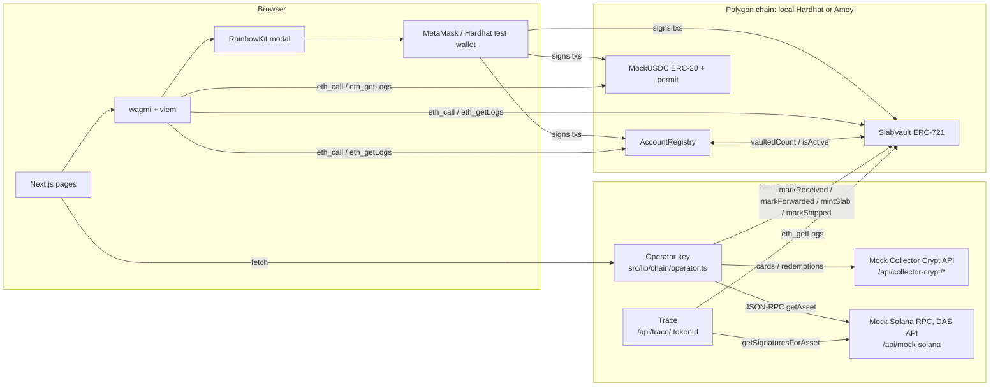
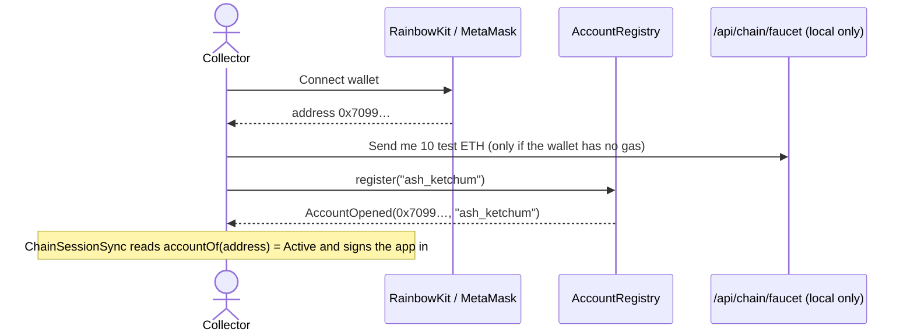
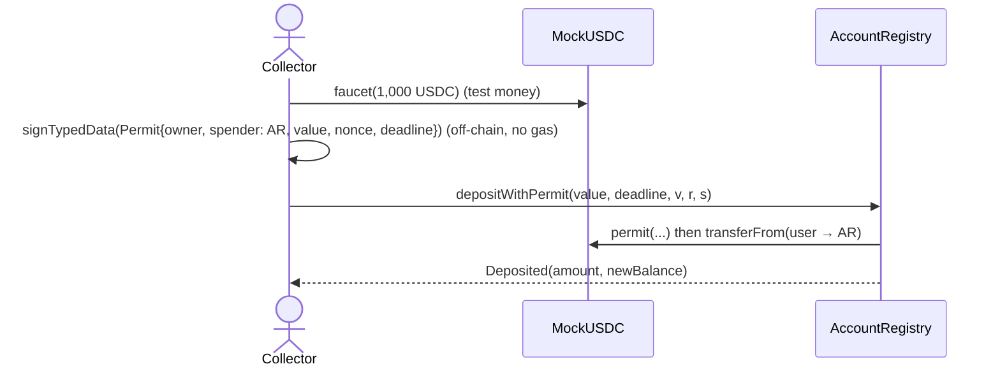
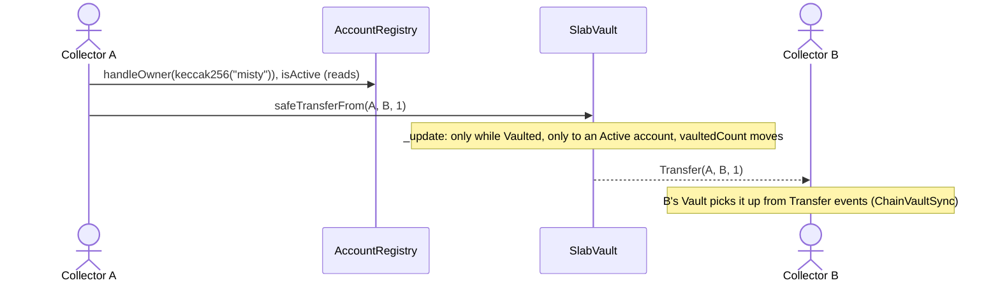
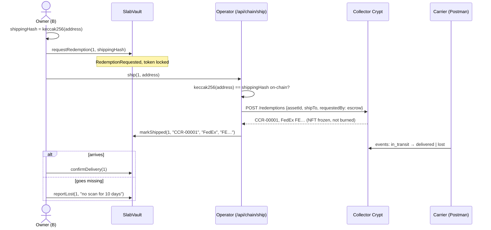

# Account and slab onboarding / offboarding on-chain

This branch moves the start and end of a collector's life on Pokechain onto a blockchain:

| | Onboarding | Offboarding |
| --- | --- | --- |
| **Account** | connect a wallet → `register(handle)` → deposit USDC | withdraw USDC → `closeAccount()` |
| **Slab** | `requestSubmission` → Pokechain receives it (`markReceived`) → forwards it to **Collector Crypt** (`markForwarded`) → CC vaults it and mints its **Solana** NFT to Pokechain's escrow → operator verifies that NFT → `mintSlab` (ERC-721 on Polygon) | `requestRedemption` (token locked, **never burned**) → Pokechain asks CC to ship → `markShipped` (with CC's redemption id) → `confirmDelivery` or `reportLost` |
| **Ownership** | | A → B: `safeTransferFrom` moves the Polygon token; CC's NFT never moves |

**The model in one line:** the physical slab sits in Collector Crypt's vault, CC's Solana NFT for it
sits locked in Pokechain's escrow wallet, and Pokechain's Polygon token is the tradeable title.
Trading moves only the Polygon token. Whoever holds it when they withdraw is who Collector Crypt ships to.

Paid trading (offers, negotiation rooms) still settles off-chain; a `TradeEscrow` contract is the next step.
This round adds a direct on-chain **Transfer to collector** so the A → B → withdraw path works end to end.

---

## 1. Architecture



Two kinds of key sign transactions:

* **The collector's wallet** (MetaMask, held in the browser): register, deposit, withdraw, close,
  submit, redeem, confirm delivery, report lost.
* **The Pokechain operator** (a server key, `OPERATOR_ROLE` in SlabVault): receive, forward, mint
  and ship. Only Pokechain's warehouse can say "the parcel arrived" or "we sent it to Collector
  Crypt", and only the holder of CC's NFT can ask CC to ship. In production this would be a Safe
  multisig or a KMS key, not an env var. (Multisig is deliberately left out of this round.)

---

## 2. Technologies and why each one is here

| Tool | Role in this project | Where |
| --- | --- | --- |
| **Solidity 0.8.28** | The three contracts | `blockchain/contracts/` |
| **OpenZeppelin Contracts 5** | `ERC721`, `ERC20`, `ERC20Permit` (EIP-2612), `AccessControl`, `Ownable`, `ReentrancyGuard`, `SafeERC20`, `Base64`. Audited building blocks instead of hand-rolled token logic | imported by every contract |
| **Hardhat 3** | Compiles, runs a local EVM node (`hardhat node`), runs Solidity unit and fuzz tests | `blockchain/hardhat.config.ts` |
| **Hardhat Ignition** | Declarative, resumable deployment: deploys the 3 contracts and wires them together | `blockchain/ignition/modules/Pokechain.ts` |
| **forge-std** | `Test`, `vm.prank`, `vm.expectRevert`, `vm.sign`, used inside Hardhat's Solidity test runner | `blockchain/test/Pokechain.t.sol` |
| **viem** | Typed Ethereum client: ABI encoding, `simulateContract`, `getContractEvents`, `keccak256`, signature parsing. Used in the browser and on the server | `src/lib/chain/*` |
| **wagmi 2** | React hooks over viem: wallet connection state, `useReadContracts` (multicall), `useWriteContract`, `useSignTypedData` | `src/lib/chain/*`, `src/components/chain/*` |
| **RainbowKit** | The Connect wallet modal (MetaMask, browser wallets, plus two local Hardhat test wallets) | `src/lib/chain/wagmi.ts` |
| **TanStack Query** | Caching and polling of chain reads (wagmi depends on it) | `Web3Providers.tsx` |
| **MetaMask** | The user's key store and transaction signer | the browser |
| **EIP-712 / EIP-2612** | Typed-data signature that authorises a USDC deposit without a separate `approve` tx | `OnChainFunds.tsx`, `AccountRegistry.depositWithPermit` |
| **Polygon Amoy** | Public testnet target (chain id 80002), explorer links to amoy.polygonscan.com | `npm run deploy:amoy` |
| **Solana DAS API** (Metaplex Digital Asset Standard, as served by Helius / Triton) | `getAsset` (is CC's NFT in our escrow?), `getSignaturesForAsset` (its history), `getAssetsByOwner` (everything in escrow) | `src/lib/collectorCrypt/*`, `/api/mock-solana` |
| **Collector Crypt** (simulated) | The vault: intake, card lookup, redemptions with carrier tracking | `/api/collector-crypt/*` |
| **Postman** | Plays Pokechain's warehouse, Collector Crypt and the carrier in a live demo | `docs/postman/` |

---

## 3. The contracts

### AccountRegistry (`blockchain/contracts/AccountRegistry.sol`)

| Function | Who | What it changes | Event / errors |
| --- | --- | --- | --- |
| `register(handle)` | wallet | Account → **Active**. Handle must be 3–20 chars of `a-z0-9_` and unclaimed. A Closed account may reopen | `AccountOpened` · `InvalidHandle`, `HandleTaken`, `AlreadyActive` |
| `deposit(amount)` | wallet | Pulls USDC via `transferFrom` (needs a prior `approve`), credits `balanceOf` | `Deposited` · `NotActive`, `ZeroAmount` |
| `depositWithPermit(amount, deadline, v, r, s)` | wallet | Same as above, authorised by an EIP-2612 signature: one tx instead of two | `Deposited` |
| `withdraw(amount)` | wallet | Debits `balanceOf`, sends USDC. Works on closed accounts too, so funds can't get stuck | `Withdrawn` · `InsufficientBalance` |
| `closeAccount()` | wallet | Refunds the whole balance, marks **Closed**. Reverts if `SlabVault.vaultedCount(you) > 0` | `AccountClosed` · `SlabsStillVaulted` |
| `accountOf`, `isActive`, `balanceOf`, `totalCustody` | anyone (view) | | |

### SlabVault (`blockchain/contracts/SlabVault.sol`), an ERC-721

Custody states: `Vaulted → RedemptionRequested → Shipped → Delivered`, or `→ Lost` (and an
operator can resolve Lost back to `Delivered` or `Vaulted`).

| Function | Who | What it changes | Event / errors |
| --- | --- | --- | --- |
| `requestSubmission(grader, cert)` | wallet | New **Pending** submission (no token yet). One physical cert can only be tokenised once | `SubmissionRequested` · `AccountNotActive`, `CertAlreadyTokenised`, `CertAlreadyPending` |
| `markReceived(submissionId)` | operator | Pending → **ReceivedByPokechain** | `SubmissionReceived` · `WrongSubmissionStatus` |
| `markForwarded(submissionId, carrier, tracking)` | operator | → **AtCustodian**; records the Pokechain → Collector Crypt parcel | `SubmissionForwarded` |
| `mintSlab(submissionId, title, image, custodianRef)` | operator | Only from AtCustodian. Mints the token to the submitter, custody **Vaulted**, stores **CC's Solana asset id** | `SlabMinted` |
| `rejectSubmission(id, reason)` | operator | Any open stage → Rejected (e.g. no such cert, damaged slab) | `SubmissionRejected` |
| `safeTransferFrom(from, to, tokenId)` | owner | **A → B**: the title changes hands. CC's NFT doesn't move | `Transfer` · `SlabLocked`, `AccountNotActive` |
| `requestRedemption(tokenId, shippingHash)` | owner | Custody → **RedemptionRequested**, token **locked**, `vaultedCount--`. Only `keccak256(address)` goes on-chain | `RedemptionRequested` |
| `markShipped(tokenId, redemptionRef, carrier, tracking)` | operator | Custody → **Shipped**; stores **CC's redemption id** | `SlabShipped` |
| `confirmDelivery(tokenId)` | owner | Custody → **Delivered** | `SlabDelivered` |
| `reportLost(tokenId, details)` | owner | Custody → **Lost** (from RedemptionRequested or Shipped) | `SlabReportedLost` (carries the tracking number) |
| `resolveLostReport(tokenId, outcome)` | operator | Lost → Delivered, or back to Vaulted | `LostReportResolved` |
| `tokenURI(tokenId)` | view | **Fully on-chain metadata**: a base64 JSON document with grader, cert, Solana ref and live custody | |
| `_update` (internal hook) | every transfer | Transfers only while **Vaulted**, only **to an Active account**, and keeps `vaultedCount` right | `SlabLocked`, `AccountNotActive` |

### MockUSDC (`blockchain/contracts/MockUSDC.sol`)

ERC-20 with 6 decimals and `permit`, plus a public `faucet(amount)` (≤ 10,000). On a real
network you would point AccountRegistry at Circle's USDC instead.

### Why the token is never burned

Withdrawn slabs must stay traceable. Burning would erase the owner, the cert link and the custody
trail at exactly the moment a parcel can go missing. Instead the token is **locked**: `_update`
refuses any transfer once custody leaves `Vaulted`. The owner keeps a permanent, verifiable record
and can file `reportLost` against it. The listing is removed from the marketplace off-chain, and the
slab shows under **Vault → Withdrawn**.

**Does Collector Crypt burn its NFT on redemption?** We don't know, so the design works either way:

* The simulated CC **doesn't burn**. On redemption its NFT stays in Pokechain's escrow, **frozen**
  and marked with the redemption, so it can never be redeemed twice. Each carrier outcome
  (delivered, lost) is written to its metadata as a Solana transaction.
* If the real CC **does burn**, the burn is itself a Solana transaction in the NFT's history
  (`getSignaturesForAsset`). Pokechain's own token still holds CC's asset id, CC's redemption id and
  the tracking number, so the trail survives on Polygon regardless.

The **Trace** page (`/trace/<tokenId>`) puts all three records side by side.

---

## 4. The flows, call by call

### Account onboarding



There is no password. "Logged in" means the connected wallet has an **Active** record in
AccountRegistry (`src/components/chain/ChainSessionSync.tsx`). Disconnecting the wallet signs you out.

### Deposit (permit)



### Slab onboarding: you → Pokechain → Collector Crypt → token

The slab's physical journey is recorded step by step, so the inbound leg is as traceable as the
outbound one. The token is only minted once Collector Crypt's NFT is provably in Pokechain's escrow.
Until then there is nothing to sell.

```mermaid
sequenceDiagram
  actor A as Collector A
  participant SV as SlabVault (Polygon)
  participant O as Pokechain operator
  participant CC as Collector Crypt (Postman)
  participant S as Solana RPC (DAS)
  A->>SV: requestSubmission("PSA", "72862688")
  Note over A: ships the slab to Pokechain
  O->>SV: markReceived(1)        (cert checked; else rejectSubmission)
  O->>SV: markForwarded(1, "SingPost", "RR…SG")
  CC->>CC: POST /intake → vaults it, mints NFT to Pokechain escrow
  Note over A: page polls CC's card lookup
  O->>CC: GET /cards/PSA/72862688 → assetId
  O->>S: getAsset(assetId)
  S-->>O: owner = Pokechain escrow, CC collection, cert, Vaulted, not burnt
  O->>SV: mintSlab(1, title, image, assetId)
  SV-->>A: SlabMinted(token #1, custodianRef = assetId)
```

`src/lib/collectorCrypt/client.ts` (`verifyCustody`) refuses to mint unless every check passes.
Both URLs are env vars (`CC_API_URL`, `SOLANA_RPC_URL`), so pointing them at real services needs
no code change: the Solana call is standard DAS `getAsset` JSON-RPC.

The Polygon token stores CC's asset id, and CC's NFT names the cert. **Each chain points at the
other**, so either side can be audited from the other.

### Ownership change: A → B



Collector Crypt's NFT doesn't move: it stays in Pokechain's escrow. **No separate contract is needed
to keep it still.** It moves only when Pokechain, its holder, asks CC to ship. Paid sales will do the
same transfer inside a `TradeEscrow` swap.

### Slab offboarding: B withdraws, Collector Crypt ships to B



The server only ships to the address whose hash the owner signed on-chain, so nobody can redirect
the parcel, not even someone calling the operator route directly.

### Account offboarding

`closeAccount()` checks `SlabVault.vaultedCount(you) == 0`, pays the custody balance back to the
wallet **in the same transaction**, marks the account Closed and emits `AccountClosed`. Nothing
is deleted: the handle stays reserved to that address, every event stays queryable, and the
tokens of withdrawn slabs still belong to the wallet.

---

## 5. "Database calls": the chain is the database

| Data | Where it lives | How the app reads it |
| --- | --- | --- |
| Account (handle, status, dates) | `AccountRegistry` storage | `accountOf(address)` |
| USDC in custody / in wallet | `AccountRegistry.balanceOf`, `MockUSDC.balanceOf` | One **multicall** of 5 `eth_call`s every 8 s (`useOnchainAccount.ts`) |
| Which tokenised slabs you own | `Transfer` events + `ownerOf` | `ChainVaultSync.tsx`: the Vault follows the chain, so a slab sent to you appears and one you sent leaves |
| Slab custody, CC redemption id, tracking | `SlabVault.slabOf(tokenId)` | `useReadContracts` in `WithdrawnList.tsx` |
| Inbound stage of a submission | `SubmissionRequested` events + `submissionOf(id)` | `getContractEvents` filtered on the indexed `owner` topic (`PendingSubmissions.tsx`) |
| Full account history | Every event across both contracts, plus transfers in and out | `eth_getLogs` filtered on your address from the deploy block (`ChainHistory.tsx`, Account page) |
| One slab's whole journey | SlabVault events by `tokenId` / `submissionId` + Solana + CC | `src/lib/chain/trace.ts` → `/trace/<tokenId>` |
| Collector Crypt records | Mock CC (`.data/collector-crypt.json`, cleared by `npm run chain`) | REST + Solana DAS JSON-RPC |
| Listings, offers, chats, wallet history | `localStorage` (unchanged) | React context (`src/lib/store.tsx`) |

Reads are free (`eth_call`, no gas). Writes are transactions. Events are the cheap, append-only
log that anyone can replay to rebuild state. That's why `ChainHistory` needs no Pokechain server. For
a 176-slab marketplace you would index these events with Ponder or The Graph (see
`docs/blockchain-stack.md`).

---

## 6. Showing the blockchain calls in a demo

* **Chain log** (bottom-left button, on every page). Every wallet tx, EIP-712 signature, operator tx
  and Collector Crypt / Solana call, with the exact function, arguments, sender, block, gas and tx hash.
  Source: `src/lib/chain/useChainTx.ts` (every write goes through `send()`, which runs
  `simulateContract` → `writeContract` → `waitForTransactionReceipt`).
* **"What happens on-chain" panels** under every action name the function, the checks it makes
  and the event it emits.
* **Account page** shows the raw view-function results, labelled with the call that produced each,
  plus the `eth_getLogs` history.
* **Trace page** (`/trace/<tokenId>`, linked from every token) lines up Polygon events, Solana
  transactions and Collector Crypt's carrier scans in one timeline.
* **The Hardhat node terminal** prints every RPC call and every mined tx with gas and block.

### A 6-minute demo script

1. `npm run chain`, then `npm run dev`, and open http://localhost:3000.
2. **Sign up** → Connect wallet → *Hardhat test collector #1* (or MetaMask) → handle `ash` → **Open account**.
   Open the Chain log: `AccountRegistry.register`.
3. **Wallet** → *Mint 1,000 test USDC* → deposit 250 with the permit box ticked. The Chain log shows
   the off-chain **Signature**, then a single `depositWithPermit` tx.
4. **Submit** (`/submit`) → PSA `72862688` → *Submit and ship to Pokechain*. A tracker appears.
5. In **Postman**, send *1 · receive*, *2 · forward*, *3 · Collector Crypt vaults it*. The tracker
   moves at each step; after 3 the page mints. The Chain log shows `markReceived`, `markForwarded`,
   `Collector Crypt GET /cards`, `Solana getAsset`, then `SlabVault.mintSlab`. Send *4 · getAsset* to
   show the escrow-held NFT the operator checked. (Each step also has a Simulate button.)
6. Sign out, connect *Hardhat test collector #2*, open account `misty`. Sign back in as `ash`,
   then in the **Vault** → **Transfer** → `misty`. Ash's Vault empties; switch to misty, and token #1 is
   in her Vault (read from `Transfer` events).
7. As misty: **Ship to me** → address → *Withdraw*. Collector Crypt redemption `CCR-00001` is created
   and recorded with `markShipped`.
8. In **Postman**, send *7 · in transit* and *8 · lost*. Then in the **Withdrawn** tab → **Report lost**.
9. Open **Trace** for token #1: Polygon, Solana and Collector Crypt, side by side.
10. **Account** → history, then **Close account** (allowed now that no slabs are vaulted).

---

## 7. Security decisions worth mentioning

* **Checks-effects-interactions + `nonReentrant`** on every function that moves USDC.
  `totalCustody` always equals the USDC the contract holds (fuzz-tested).
* **Role separation** with `AccessControl`: only `OPERATOR_ROLE` can mint or ship. Collectors can only
  act on their own tokens (`NotSlabOwner`).
* **Cross-chain custody proof** before minting, so a token can't exist unless Collector Crypt's NFT
  for that slab is in Pokechain's escrow.
* **Enforced stage order** for the inbound trail (`_moveSubmission` → `WrongSubmissionStatus`): no
  minting before the slab has reached Collector Crypt.
* **Ship only where the owner signed:** the operator ships only to an address whose `keccak256`
  matches the `shippingHash` the owner put on-chain.
* **CC's NFT never moves while trading**, so the same slab can't be sold on Pokechain and redeemed
  or sold elsewhere. CC refuses redemptions from anyone but the NFT's holder.
* **One cert, one token** (`tokenOfCert`, `pendingSubmissionOfCert`): no double-tokenising.
* **Locked, not burned** on redemption: no trading of a slab that's in transit, and a permanent trail.
* **Only active accounts can receive slabs** (`_update`), the on-chain equivalent of a KYC gate.
* **Privacy:** the shipping address never goes on-chain, only `keccak256(address)`, which the
  operator can later match.
* **Permit front-running tolerated:** `depositWithPermit` wraps `permit` in `try/catch`, so a
  front-run permit can't block the deposit.
* **Custom errors** (cheaper than revert strings), decoded into friendly text by
  `describeError` in `useChainTx.ts`, after a `simulateContract` dry run that catches the revert
  before the wallet even opens.

---

## 8. Recreate it from scratch

Requirements: Node 20+ (`./dev.sh` pins Homebrew Node), and optionally MetaMask.

```bash
npm run setup          # installs the app and blockchain/ dependencies
npm run contracts:test # 27 Solidity unit + fuzz tests
npm run chain          # terminal 1: local chain + deploy + ABI export (leave running)
npm run dev            # terminal 2: the app on http://localhost:3000
```

`npm run chain` starts a fresh Hardhat node, deploys with Ignition and runs
`blockchain/scripts/export-frontend.mjs`. That writes every ABI and address into
`src/lib/chain/generated.ts`, so the frontend's types always match the deployed contracts. The node
is in-memory: restart it and everything resets to block 0 (with the same addresses), and the mock
Collector Crypt records are cleared to match. Use **Reset demo data** in the user menu to clear the
browser side too.

**Using MetaMask on the local chain:** connect with MetaMask and approve *Add network* (RPC
`http://127.0.0.1:8545`, chain id 31337). Press *Send me 10 test ETH* for gas. After restarting the
chain, use MetaMask → Settings → Advanced → **Clear activity tab data**, or it will reuse stale nonces.

### Deploy to Polygon Amoy

```bash
cd blockchain
npx hardhat keystore set AMOY_RPC_URL       # e.g. an Alchemy / Infura Amoy URL
npx hardhat keystore set AMOY_PRIVATE_KEY   # a throwaway key funded from faucet.polygon.technology
npm run deploy:amoy                         # deploys + exports addresses for chain 80002
```

Then in `.env.local`: `NEXT_PUBLIC_CHAIN=amoy` and `OPERATOR_PRIVATE_KEY=<the same key>` (the
deployer is the operator). Chain log entries now link to amoy.polygonscan.com.

### Postman

Import `docs/postman/Pokechain.postman_collection.json`. Collection variables: `baseUrl`
(default `http://localhost:3000`), `submissionId`, `grader`, `certNumber`, `tokenId`, `redemptionId`.
Request 3 stores the returned `assetId` and escrow wallet; request 6 stores the `redemptionId`.

---

## 9. File map

```
blockchain/
  contracts/AccountRegistry.sol   account onboarding / offboarding, USDC custody
  contracts/SlabVault.sol         ERC-721 slab tokens, custody state machine
  contracts/MockUSDC.sol          test USDC with EIP-2612 permit
  test/Pokechain.t.sol            27 unit + fuzz tests
  ignition/modules/Pokechain.ts   deployment + wiring
  scripts/dev-chain.mjs           npm run chain
  scripts/export-frontend.mjs     ABIs + addresses → src/lib/chain/generated.ts
src/lib/chain/
  config.ts          chain selection, contract {address, abi}, enums, explorer links
  wagmi.ts           RainbowKit wallets, Hardhat test wallets, wagmi config
  useChainTx.ts      simulate → write → receipt, error decoding, Chain log
  useOnchainAccount.ts  multicall of the account's on-chain state
  useSlabChain.ts    submit / receive / forward / verify+mint / transfer / redeem / confirm / report lost
  operator.ts        server-side operator key: markReceived, markForwarded, mintSlab, markShipped, gas faucet
  trace.ts           one slab's journey across Polygon, Solana and Collector Crypt
src/lib/collectorCrypt/
  store.ts           mock Collector Crypt: vault intake, redemptions, carrier events, DAS asset shape
  client.ts          how the operator calls CC and Solana: custody check, shipment, trace
src/app/api/
  chain/{receive,forward,mint,ship,faucet}   operator routes
  collector-crypt/{intake,cards,redemptions} mock Collector Crypt REST
  mock-solana                mock Solana DAS JSON-RPC
  trace/[tokenId]            cross-chain trace
src/app/trace/[tokenId]      the Trace page
src/components/chain/        AccountView, OnChainFunds, PendingSubmissions, TransferModal, RedeemModal,
                             WithdrawnList, TraceView, ChainHistory, ChainConsole, ChainSessionSync,
                             ChainVaultSync, ChainDownBanner
```

## 10. Limitations (what to say if asked)

* Collector Crypt and its Solana NFTs are **simulated**. The Solana calls use the real DAS shapes
  (`getAsset`, `getSignaturesForAsset`, `getAssetsByOwner`), but nothing is on Solana devnet and CC's
  real API may differ. Swapping in real endpoints is two env vars plus adapting `client.ts`.
* The Solana escrow is a single wallet address; in production it would be a Squads multisig (and the
  Polygon operator a Safe).
* The operator API routes are unauthenticated. They only act on state already on-chain (a pending
  submission or a requested redemption), but production would also authenticate the caller and
  run the operator as a multisig.
* Offers and trades still use the off-chain wallet balance. Deposits and withdrawals are mirrored
  into it with their tx hash. Moving trades into an escrow contract is the next step
  (`docs/blockchain-stack.md`, section 1).
* Slabs bought off-chain are tokenised on first withdrawal (the same submit → Pokechain → CC → mint path).
* A → B is a direct transfer this round (no payment). Paid sales need `TradeEscrow`.
